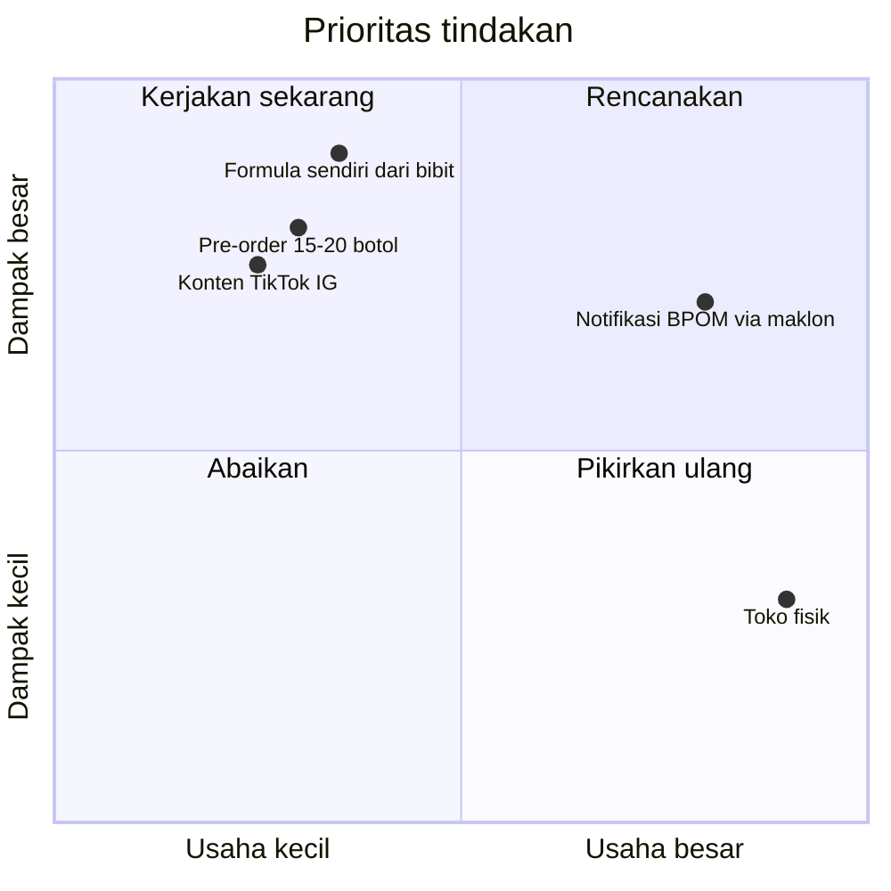

# Tahap 3: SWOT dan TOWS (Brand Parfum Malang)

Status: lokal saja, belum di-push. Tanggal: 2026-11-21.
Dasar bukti: [riset pasar](../../ideas/parfum-malang/2026-11-21-riset-pasar.md) dan [validasi ide](../../ideas/parfum-malang/2026-11-21-validasi.md).
Tanda: **[F]** fakta dari riset, **[A]** asumsi yang belum terbukti.

## SWOT

### Strengths (internal)
| Poin | Label |
|---|---|
| Modal kecil Rp1 juta cukup untuk uji pasar, risiko kerugian terbatas | [F] dari konteks user |
| Ada minat dan selera meracik, sudah mencoba layering | [F] |
| Margin kotor tinggi, biaya bahan sekitar Rp8-15 ribu per botol 30 ml | [A] dari listing marketplace |
| Dekat dengan segmen target (kamu paham dunia mahasiswa Malang) | [A] perlu dikonfirmasi |
| Akses bibit dari distributor, Rp100 ribu per 100 ml (info user). Ini kisaran menengah-premium, bukan paling murah (riset: lokal Rp15-35 ribu, premium Rp40-100 ribu+) | [F] harga dari user, kualitas belum diverifikasi |
| Punya kotak kemasan elegan, custom sendiri Rp2.000 per pcs (info user). Bisa dipesan ulang dan harganya masuk, jadi pembeda tampilan yang bisa diskalakan | [F] dari user |
| Rencana harga jual Rp75 ribu per botol 35 ml. Per ml sekitar 6x lebih mahal dari pesaing massal (Rp30-45 ribu per 100 ml), jadi posisinya premium-terjangkau, bukan murah | [F] hitungan dari data riset |
| Tim teman bisa bergantian meracik, modal tetap Rp1 juta | [F] dari user |

### Weaknesses (internal)
| Poin | Label |
|---|---|
| Belum punya formula sendiri. Racikan saat ini memakai parfum branded, tidak bisa dijual | [F] |
| Belum punya audiens dan brand. Supplier bibit sudah ada (lihat Strengths) | [F] |
| Bibit tidak punya dokumen keamanan (SDS/IFRA). Keamanan kulit dan kepatuhan belum bisa dibuktikan, dan dokumen ini dibutuhkan untuk notifikasi BPOM. "Kualitas terjamin" belum terbukti | [F] dari user |
| Modal terbatas, tidak cukup untuk BPOM/maklon dan stok besar | [A] biaya maklon belum dicek |
| Belum ada pengalaman uji stabilitas dan konsistensi batch | [A] |
| Belum jelas dikerjakan penuh waktu atau sambilan | [F] belum dijawab |

### Opportunities (eksternal)
| Poin | Label |
|---|---|
| Tren layering, genderless, gourmand-woody di Gen Z cocok dengan gayamu | [F] |
| Tren aroma bahan lokal (nilam, cengkeh, kenanga), peluang cerita "Malang" | [F] |
| Sekitar 22 ribu mahasiswa baru masuk Malang tiap tahun | [F] |
| TikTok Shop dan media sosial membuat brand kecil bisa dikenal tanpa toko | [F] |
| Kemungkinan biaya notifikasi BPOM gratis untuk usaha mikro/kecil | [A] belum terverifikasi |

### Threats (eksternal)
| Poin | Label |
|---|---|
| Pesaing massal menjual Rp30-45 ribu untuk 100 ml | [F] |
| Brand lokal besar (Saff & Co, HMNS) dominan dan makin masuk toko fisik | [F] |
| Regulasi BPOM: kosmetik wajib notifikasi, produksi di fasilitas CPKB | [F] |
| Mahasiswa sensitif harga dan jarang repeat order | [A] |
| Risiko merek jika meniru atau memakai nama parfum branded | [F] |

## TOWS: strategi dari silang

| | **Opportunities** | **Threats** |
|---|---|---|
| **Strengths** | **SO:** Buat 2 aroma dasar untuk layering (gourmand dan woody), dengan cerita Malang. Gunakan modal kecil untuk batch kecil lewat pre-order. | **ST:** Jangan perang harga. Jual sebagai produk "personal dan komunitas" dalam botol kecil, bukan parfum murah 100 ml. |
| **Weaknesses** | **WO:** Bangun audiens lewat konten proses meracik di TikTok/IG sebelum produksi. Cari bibit dan supplier selagi audiens tumbuh. | **WT:** Ganti racikan branded dengan formula dari bibit sendiri. Tunda BPOM sampai permintaan terbukti, lalu pakai maklon CPKB. Mulai sebagai uji pasar terbatas. |

## Prioritas dari SWOT

## Kesimpulan tahap ini
- Kekuatan terbesarmu adalah modal rendah dan tren yang cocok. Kelemahan terbesar adalah formula, audiens, dan legal.
- Strategi utama: **formula sendiri, layering, cerita Malang, pre-order kecil**, bukan bersaing harga.
- Pertanyaan yang masih terbuka: apakah kamu bisa menyisihkan waktu rutin, dan apakah modal Rp1 juta bisa ditambah atau tidak.
