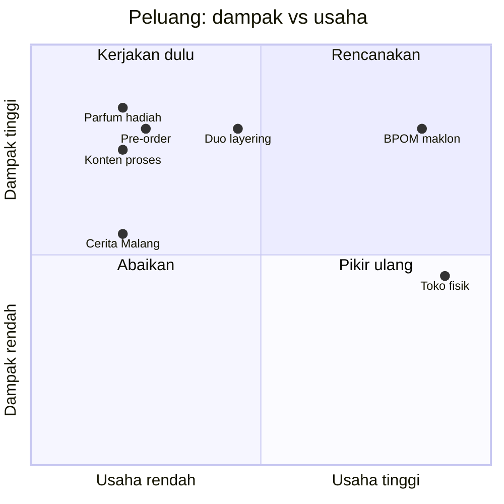

# Tahap 4: Opportunity dan Environment (Brand Parfum Malang)

Status: lokal saja, belum di-push. Tanggal: 2026-11-21.
Dasar: [08-swot.md](08-swot.md) dan [riset pasar](../../ideas/parfum-malang/2026-11-21-riset-pasar.md).
Tanda: **[F]** fakta (dari riset atau user), **[A]** asumsi.

## 1. Peluang diurutkan (dampak vs usaha)

| # | Peluang | Dampak | Usaha | Catatan |
|---|---|---|---|---|
| 1 | **Parfum hadiah premium-terjangkau** (35 ml, kotak custom, Rp75 ribu) | Tinggi | Rendah | Kotak Rp2.000 per pcs sudah ada. Kado mahasiswa (ulang tahun, wisuda, anniversary) tidak sensitif harga seperti beli harian. [A] |
| 2 | **Duo layering** (2 aroma dasar yang dirancang untuk dipadukan) | Tinggi | Sedang | Mengikuti tren layering Gen Z [F]. Menaikkan nilai bundling, jual 2 botol sekaligus. |
| 3 | **Cerita Malang** (nama aroma dan kemasan terinspirasi tempat, mis. Batu, Kayutangan, Bromo) | Sedang | Rendah | Pembeda cerita, bukan formula. Cocok untuk oleh-oleh wisatawan. [A] |
| 4 | **Konten proses meracik** di TikTok/IG oleh tim | Tinggi | Rendah | Membangun audiens sebelum stok. Tim bisa bergantian [F]. |
| 5 | **Pre-order batch kecil** | Tinggi | Rendah | Mengurangi risiko stok, cocok modal Rp1 juta. |
| 6 | **Notifikasi BPOM via maklon CPKB** | Tinggi | Tinggi | Tunda sampai permintaan terbukti dan dokumen bibit lengkap. |
| 7 | Toko fisik / ritel | Sedang | Tinggi | Tidak sekarang. |

## 2. PESTEL

| Faktor | Temuan | Label |
|---|---|---|
| Political / Legal | Parfum = kosmetik, wajib notifikasi BPOM, produksi di fasilitas CPKB. Dokumen bahan dan formula dibutuhkan. | [F] riset |
| Political / Legal | Klaim biaya notifikasi gratis untuk usaha mikro/kecil belum terverifikasi. | [A] |
| Economic | Pesaing massal Rp30-45 ribu per 100 ml. Mahasiswa sensitif harga. Produkmu 6x lebih mahal per ml. | [F] hitungan dari riset |
| Social | Gen Z suka layering, genderless, gourmand-woody. Mahasiswa baru ~22 ribu per tahun di Malang. | [F] riset |
| Technological | TikTok Shop, IG, dan marketplace memungkinkan jualan tanpa toko. | [F] |
| Environmental | Kemasan dan botol kaca/kotak. Belum ada temuan khusus. | [A] |
| Legal (merek) | Jangan memakai nama atau meniru parfum branded. Cek ketersediaan nama brandmu di pangkalan data merek DJKI. | [A] belum dicek |

## 3. Porter's Five Forces

| Kekuatan | Tingkat | Alasan |
|---|---|---|
| Persaingan antar pemain | **Tinggi** | Saff & Co, HMNS, Evangeline, Morris, Pucelle, dan banyak brand rumahan. [F] |
| Ancaman pendatang baru | **Tinggi** | Modal kecil dan bibit mudah dibeli. Siapa pun bisa mulai. [F] |
| Kekuatan pembeli | **Tinggi** | Banyak pilihan murah, perpindahan merek tanpa biaya. [F] |
| Kekuatan pemasok | **Sedang** | Distributor bibit banyak, tapi dokumen keamanan tidak otomatis ada. [A] |
| Ancaman substitusi | **Sedang-tinggi** | Body mist, parfum refill, decant, dan parfum branded diskon. [A] |

Kesimpulan: pasar ini sulit di harga dan mudah dimasuki, jadi keunggulan harus datang dari **merek, kemasan, cerita, dan komunitas**, bukan dari biaya.

## 4. Diferensiasi dan positioning

**Bukan:** "parfum murah dari bibit murah". Itu tidak benar dan lemah.
**Tapi:** parfum hadiah premium-terjangkau dari Malang.

| Elemen | Isi |
|---|---|
| Target utama | Mahasiswa dan pelajar yang mencari kado terjangkau, plus wisatawan muda |
| Janji | "Kado parfum yang terlihat mewah, racikan lokal Malang, Rp75 ribu" |
| Produk | Botol 35 ml, kotak custom, 2 aroma dasar untuk layering |
| Bukti | Dokumen bibit (SDS/IFRA), patch test, formula tercatat, ulasan pembeli awal |
| Yang dihindari | Perang harga, klaim "kualitas terjamin" tanpa bukti, meniru parfum branded |

## 5. Syarat sebelum peluang dijalankan

| Syarat | Alasan |
|---|---|
| Dapat SDS/IFRA dari distributor, atau ganti distributor | Keamanan kulit dan dokumen BPOM |
| Formula sendiri dari bibit, tercatat | Konsistensi dan legal |
| Nama brand diperiksa di DJKI | Hindari sengketa merek |
| Uji keawetan sederhana (4-8 jam di kulit dan baju) | Dasar klaim |

## Kesimpulan tahap ini
- Peluang terbaik: **parfum hadiah**, **duo layering**, **konten proses**, dan **pre-order**. Semuanya usaha rendah-sedang.
- Pasar sangat kompetitif, jadi hanya merek dan kemasan yang bisa jadi pembeda.
- Syarat keamanan bibit harus beres sebelum jualan luas.
