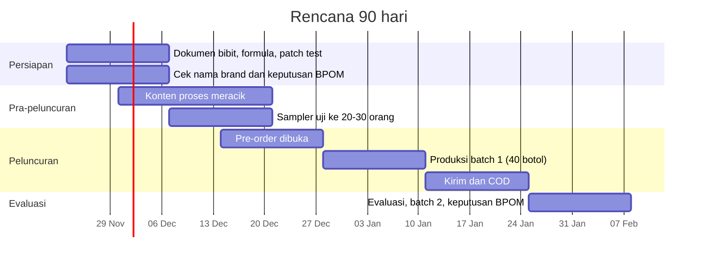

# Tahap 7: Go-to-Market dan Risiko (Brand Parfum Malang)

Status: lokal saja, belum di-push. Tanggal: 2026-11-21.
Dasar: [09-opportunity-analysis.md](09-opportunity-analysis.md), [10-management-plan.md](10-management-plan.md), [11-financial-plan.md](11-financial-plan.md).
Tanda: **[F]** dari user atau riset, **[A]** asumsi.

## 1. Gerbang sebelum jualan (harus dilewati dulu)

| # | Syarat | Status saat ini |
|---|---|---|
| 1 | SDS/IFRA bibit dari distributor (atau ganti distributor) | Belum ada [F] |
| 2 | Formula sendiri dari bibit, tercatat | Belum, racikan awal memakai parfum branded [F] |
| 3 | Patch test dan uji keawetan | Belum |
| 4 | Nama brand dicek di DJKI | Belum |
| 5 | Keputusan soal BPOM (lihat bagian 6) | Belum |

Selama gerbang 1-3 belum beres, hanya bagikan sampel ke lingkaran terdekat untuk uji, jangan jual luas.

## 2. Posisi dan pesan

- **Produk:** parfum hadiah 35 ml, kotak custom, 2 aroma dasar untuk layering.
- **Pesan utama:** "Kado parfum yang terlihat mewah, racikan lokal Malang."
- **Bukan:** "murah" dan "kualitas terjamin" (belum ada bukti).
- **Harga uji:** Rp65 ribu dan Rp75 ribu di pre-order.

## 3. Kanal

| Kanal | Peran | Biaya | Catatan |
|---|---|---|---|
| TikTok / Instagram | Utama, kontenmu proses meracik, unboxing kotak | Gratis | Bangun audiens sebelum stok |
| WhatsApp / Business | Pre-order, repeat order, pembayaran | Gratis | Daftar pelanggan |
| Kampus dan organisasi | COD, bazar, kado ulang tahun/wisuda | Rendah | Titik COD |
| Marketplace (TikTok Shop, Shopee) | Tahap 2, setelah pre-order | Komisi (belum diverifikasi) | Perlu penataan listing dan data bahan |
| Toko fisik | Tidak sekarang | Tinggi | Tunda |

## 4. Rencana 90 hari

| Fase | Minggu | Fokus | Hasil yang diharapkan |
|---|---|---|---|
| Persiapan | 1-2 | Dokumen bibit, formula, patch test, nama brand | Gerbang 1-4 selesai |
| Pra-peluncuran | 2-5 | Konten, sampler 5 ml ke 20-30 orang | Audiens awal, umpan balik aroma |
| Peluncuran | 4-8 | Pre-order, produksi, kirim | 15-20 pre-order, 40 botol |
| Evaluasi | 8-12 | Hitung laba, batch 2, ulasan | Keputusan: lanjut, ubah, atau BPOM |

Tanggal di atas contoh jadwal, sesuaikan dengan kesiapan gerbang.

## 5. Eksperimen dan keputusan

| Data | Keputusan |
|---|---|
| Pre-order kurang dari 10 | Ubah pesan, harga, atau produk. Jangan produksi batch 1 penuh. |
| Pre-order 15-20 | Produksi 40 botol, lanjut. |
| Pre-order lebih dari 40 dan repeat order | Siapkan notifikasi BPOM via maklon. |
| Ada keluhan kulit | Hentikan batch, selidiki bibit, wajibkan dokumen. |

## 6. Soal BPOM: jujur soal risiko

- Secara aturan, parfum yang diedarkan ke publik wajib notifikasi BPOM. Menjual tanpa notifikasi melanggar aturan dan berisiko (penarikan, sanksi, penolakan marketplace, reputasi brand).
- Uji pasar kecil di lingkaran sendiri adalah area abu-abu. Keputusan dan risikonya ada di kalian. Aku sarankan memperlakukannya hanya sebagai uji sampel dan umpan balik, bukan penjualan luas, dan tidak mengklaim izin yang belum ada.
- Rencana jujur: kumpulkan bukti permintaan, lalu danai notifikasi lewat maklon CPKB dari laba, setelah tahu biayanya.

## 7. Daftar risiko

| Risiko | Kemungkinan | Dampak | Mitigasi |
|---|---|---|---|
| Bibit tanpa dokumen keamanan menyebabkan iritasi | Sedang | Tinggi | SDS/IFRA wajib, patch test, tarik batch bila ada keluhan |
| Jual tanpa BPOM | Tinggi jika abaikan gerbang | Tinggi | Keputusan sadar, pilih uji terbatas, rencana maklon |
| Pre-order sepi, harga Rp75 ribu terlalu tinggi | Sedang | Tinggi | Uji dua harga, fokus pasar kado |
| Kualitas antar batch tidak konsisten | Sedang | Sedang | Formula tercatat, satu pemegang formula |
| Racikan memakai parfum branded | Rendah jika diganti | Tinggi | Ganti ke formula dari bibit, tanpa nama brand lain |
| Sengketa nama brand | Rendah-sedang | Sedang | Cek DJKI sebelum cetak kotak banyak |
| Konflik antar teman | Sedang | Sedang | Aturan bagi hasil tertulis |
| Stok tidak laku, modal Rp1 juta habis | Sedang | Tinggi | Produksi berdasarkan pre-order, batch kecil |
| Pesaing massal menurunkan harga | Tinggi | Sedang | Jangan perang harga, fokus kemasan dan kado |
| Waktu tim terbatas (kuliah) | Tinggi | Sedang | Produksi per batch di akhir pekan |

## Ringkasan akhir

- **Konsep:** parfum hadiah 35 ml dari Malang, kotak custom, 2 aroma layering, harga Rp65-75 ribu.
- **Keuangan:** biaya sekitar Rp16.400 per botol, break-even sekitar 20 botol, modal Rp1 juta cukup untuk 40 botol.
- **Syarat utama:** dokumen bibit, formula sendiri, patch test, keputusan BPOM, nama brand.
- **Langkah pertama minggu ini:** minta SDS/IFRA ke distributor, mulai tulis formula dari bibit, bagi aturan bagi hasil, dan mulai konten.
